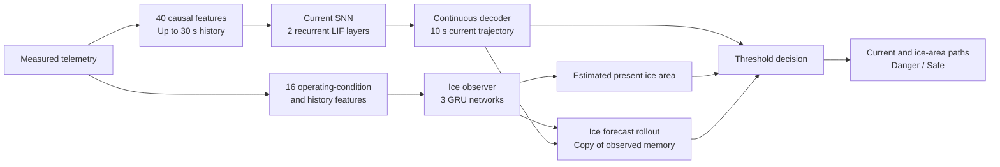

# Drone propeller icing forecasting

**A hybrid neural system that forecasts motor current, estimates propeller ice area, and provides an interpretable warning.**

## The problem and motivation

Imagine a drone carrying assistance to someone who is difficult to reach. Its route may pass through cold clouds or other challenging weather conditions. Ice accumulating on the propeller can change its aerodynamic behaviour and the load on the motor, putting the mission and the aircraft at risk.

The question behind this project is: **can onboard telemetry help us recognize a developing icing condition before it becomes critical?** A warning could allow a flight-control system to reconsider the route, leave an icing environment, or end the flight. Choosing and executing that action is outside this project; our role is to supply the forecast and warning that can inform it.

Motor current offers a useful signal because it responds to changing load. But current also changes with RPM, throttle, voltage and operating conditions. A current increase alone is therefore not a direct measurement of ice. We interpret it together with weather conditions and its recent history.

The proposed solution has two neural components: a **Spiking Neural Network (SNN)** that forecasts current, and a separate **Gated Recurrent Unit (GRU) ensemble** that estimates ice area. A transparent decision layer combines their outputs.

## Architecture at a glance



The networks have separate weights, feature transforms and memory. The GRU uses the SNN's predicted current to construct a future ice-area path. Its ice estimate is not fed back into the SNN.

## The current forecaster: a recurrent SNN

The SNN receives a sequence of telemetry features sampled at **5 Hz**. A complete 30-second window contains 150 observations, each with 40 features. These describe measured conditions, recent changes and missing values. All features are causal: they use information already available at the time of prediction.

Its backbone contains **two recurrent leaky integrate-and-fire layers, with 48 neurons per layer**. Each neuron accumulates input in a membrane state, gradually loses part of that state through decay, and emits a spike when it reaches a threshold. Recurrent connections allow previous spike activity to affect the next time step. The layers begin with different decay time scales, which can be learned during training.

The output is a continuous current trajectory. The last spiking layer supplies 48 membrane values and 48 recent spike-activity traces. A **96 → 48 → 50 decoder**, with a `Tanh` hidden activation, converts that representation into 50 predicted changes relative to the latest measured current. After conversion back to physical units, the network outputs amperes at **+0.2, +0.4, …, +10 seconds**.

Training uses surrogate gradients: forward computation retains binary spikes, while a differentiable approximation allows gradients to reach the spiking layers. The implementation runs in software with PyTorch; neuromorphic hardware deployment and an energy advantage have not been demonstrated here.

### Three supporting design decisions

**Sliding Window.** Each new sensor tick updates the measured-history window. The SNN processes that window in chronological order, starting with fresh neural state, and produces a new complete forecast. Consecutive forecasts overlap in target time; we do not append one predicted value to the previous trajectory.

**Divided Inputs.** Persistent current drops associated with shedding are marked, and the current training data is separated into segments around the transition. Training windows cannot bridge excluded transition regions. This focuses learning on trajectories within operating regimes. Drops remain in evaluation, and segmentation itself does not establish advance prediction of ice fracture.

**Forecast Feedback.** Once all actual current values for an issued 10-second forecast have arrived, the system can compare prediction with observation. Small, constrained updates affect only the final **48 → 50 linear readout**; the spiking backbone and first decoder layer stay fixed. Confirmed drops clear stale adaptation context. Predicted current is not recycled as if it were a new sensor measurement.

## The ice observer: a separate GRU ensemble

Ice area is not assumed to be directly observable during operation. Camera-derived area can serve as a training target, but the live observer receives only telemetry.

The designed observer averages the predictions of **three independently trained GRU models**. Each has one recurrent layer with **16 input features and 16 hidden units**. GRU gates control how much historical information is retained or replaced as new measurements arrive. This provides persistent memory for interpreting the development of an icing condition.

Each model combines its 16-dimensional hidden output with the 16 input features through a telemetry skip connection. A **32 → 1 linear readout followed by Softplus** produces a nonnegative area estimate. The output is scaled to **square millimetres** and the three estimates are averaged.

The 16 features include temperature, liquid water content, current and RPM, together with current slopes, recent means and fluctuations, voltage, RPM tracking error, and normalized electrical-power features. The power proxy is:

```text
normalized power = voltage × current × (3000 / RPM)³
```

This normalization is motivated by propeller power scaling. It is a load-related feature, rather than a complete physical model or a direct conversion from current to ice.

The observer operates at **1 Hz**. Its feature history requires 30 valid one-second samples before an estimate is available. Its recurrent state persists across updates and electrical shedding detections, and resets for a new independent trial or a measurement gap. It is trained separately on full ice trajectories, including transitions; the SNN's divided training view is not applied to its targets.

To forecast ice area, the system uses a copy of the observer's feature history and hidden states. The SNN's predicted current supplies ten future one-second samples; other telemetry is held at its present value. This produces an ice-area path at **+1 through +10 seconds** without changing the live observer's memory. Holding future operating conditions constant is an explicit assumption of the prototype.

## From forecasts to a warning

The combined interface provides current predictions, estimated present and future ice area, and a threshold-based decision:

```text
Danger if current > 14 A OR estimated ice area > 800 mm²,
now or anywhere within the next 10 seconds.
```

For each future one-second interval, the decision examines all five current predictions in that interval and the ice-area estimate at its endpoint. Either threshold can trigger the warning, and the output identifies which criterion was crossed.

These are project-defined criteria, not certified flight-safety limits. **Safe** means neither criterion is exceeded by the measurements and estimates being evaluated; it is not a guarantee of overall aircraft safety. Before sufficient history is available, status is unavailable rather than Safe. This decision layer is an explicit rule applied to neural outputs, not a learned binary classifier.

## Data structures and processing

The live input is a timestamp and a **12-value telemetry vector** in the order defined by [`RAW_COLUMNS`](model/uav_snn/data.py): current, measured RPM, target RPM, throttle, voltage, test-section temperature, liquid water content, two calibrated sensor temperatures, and three strain-related channels. Camera ice area, ice pixels and trial IDs are excluded from the neural input vectors.

| Stage | Structure | Purpose |
| --- | --- | --- |
| Sensor input | 12 telemetry values every 0.2 s | Observed operating conditions |
| Current features | 40 values: 12 raw channels, 16 derived features, 12 missingness flags | Causal context for the SNN |
| Full SNN window | `[batch, 150, 40]` | Up to 30 seconds of measured history |
| Current output | 50 values in A | Future trajectory at 0.2-second spacing |
| Ice features | 16 values per one-second observation | Operating conditions and load history |
| GRU memory | 16 hidden values per ensemble member | Persistent state for area estimation |
| Ice output | Present area plus 10 future values in mm² | Current and projected icing state |
| Decision output | Overall status, per-second statuses and trigger flags | Explainable warning |

During training, data remains grouped by its original trial. Dividing a trial into segments does not permit those segments to be distributed across training and evaluation groups. Normalization is fitted on training observations and kept fixed during inference. Camera area supplies ice supervision only; future measurements arrive later as labels rather than entering the forecast inputs.

The caller aligns sensor observations causally, calls the combined API every 0.2 seconds, and resets at independent trials or measurement gaps. Current predictions are updated at sensor cadence. The combined ice and decision result is issued once per second after warmup.

## Repository contents

This public edition contains source code, a generic configuration and tests built from artificial signals. **Experimental datasets, trained weights, fitted normalization values, experiment results, plots and notebooks are excluded.** No experimental performance figures are published in this edition.

Useful entry points:

| File | Responsibility |
| --- | --- |
| [`network.py`](model/uav_snn/network.py) | Recurrent LIF layers, surrogate gradients and continuous decoder |
| [`data.py`](model/uav_snn/data.py) | Telemetry schema, causal features, preparation and scaling |
| [`regime_data.py`](model/uav_snn/regime_data.py) | Divided Inputs preparation |
| [`regime_stream.py`](model/uav_snn/regime_stream.py) | Sliding-window forecasts and event handling |
| [`feedback.py`](model/uav_snn/feedback.py) | Delayed final-readout adaptation |
| [`physics_ice.py`](model/uav_snn/physics_ice.py) | Physical features, GRU architecture and persistent ice observer |
| [`danger.py`](model/uav_snn/danger.py) | Combined current/ice interface and threshold decisions |

### Setup and synthetic tests

From the repository root, using Python 3.12 or newer:

```sh
python3 -m venv model/.venv
model/.venv/bin/python -m pip install -r model/requirements.lock.txt
model/.venv/bin/python -m unittest discover -s model/tests -v
```

Tests do not require the experimental dataset or trained weights. The example configuration uses placeholder trial IDs and an absent private-data path. Historical comparison routines require independently generated local runs; their experiment artifacts are not bundled.

### Load independently trained or authorized private artifacts

```python
from model.uav_snn.danger import IcingDangerForecaster
from model.uav_snn.data import RAW_COLUMNS

forecaster = IcingDangerForecaster(
    "path/to/private/current_checkpoint.pt",
    "path/to/private/ice_observer_bundle",
)

# At each causally aligned 0.2-second sensor tick:
# result = forecaster.update(timestamp_seconds, telemetry_in_RAW_COLUMNS_order)
# None: no combined issue on this tick.
# ready=False: the system is still collecting warmup history.
# ready=True: current/ice paths, statuses and trigger flags are available.
```

Trained artifacts are required for inference; this repository does not ship a ready-to-run pretrained predictor. Keep private datasets and artifacts outside the public repository. The included Git allowlist restricts normal additions to the reviewed source layout, and the repository starts with a separate history containing no experimental files.

## Current scope

This is a software research prototype for forecasting and warning. Reliable anticipation of sudden ice fracture, robustness across aircraft and weather conditions, operational false-alarm performance, and flight-control integration remain open validation tasks. The rescue scenario motivates the work; an autonomous rescue deployment has not been demonstrated.
